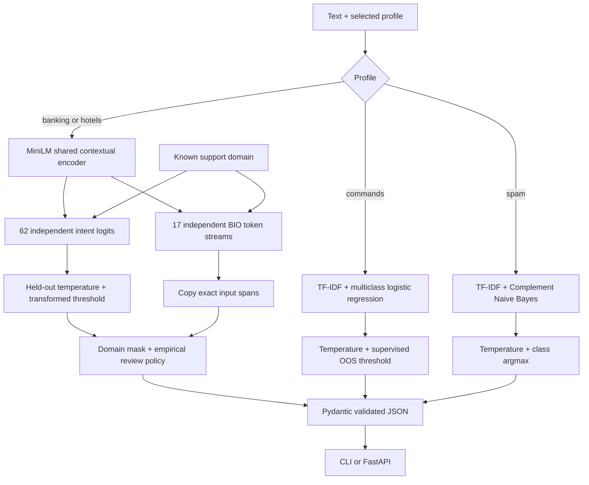

# How ReflexOne is put together

ReflexOne is a collection of locally trained text decision profiles with one CLI/API, rather than an autoregressive chat model. The known profile chooses a model; the system does not infer which profile a request belongs to.

## Module boundaries

| File | Responsibility |
|---|---|
| `data.py` | Pinned support downloads, annotation validation, canonicalization, grouping and split provenance |
| `model.py` | Neural encoder/heads, masked losses, exact span alignment, BIO decoding |
| `training.py` | Fine-tuning, validation checkpoint selection, baseline, calibration, frozen test evaluation |
| `reliability.py` | Stable temperature fitting, multilabel metrics, tied-score-aware risk/coverage |
| `tasks.py` | CLINC150 and SMS preparation, classical training, calibrated rejection, trusted artifact loading |
| `schema.py` | Input validation, ontology-constrained output labels and span fidelity |
| `inference.py` | Loaded neural predictor, deployed review policy and scoped CPU benchmark |
| `api.py` | Model lifecycle and single/mixed batch prediction routes |
| `cli.py` | Commands for training, evaluation, prediction and serving |

## Neural forward pass

The six-layer MiniLM encoder maps subwords to contextual vectors of width 384. Masked mean pooling produces a sentence vector. A learned 16-dimensional domain embedding is concatenated to that pooled vector for the intent MLP; the same domain vector is concatenated to every token for extraction.

Intent output is `[batch,62]`, interpreted through sigmoid as 62 marginal yes/no probabilities. The known domain removes inapplicable outputs. Extraction is `[batch,tokens,17,3]`: each of 17 field types gets its own O/B/I distribution. Two different field types can overlap in the input, which a single BIO stream cannot represent.

All heads use one encoder call. Output labels are taken from a fixed ontology; entity text is sliced from original input offsets. This constrains structure and prevents invented strings as entity values. Wrong labels, missing spans, and wrong boundaries remain possible and are measured.

## Data lifecycle

Preparation records raw source hashes and source row IDs; only the duplicate-group key is normalized. A normalized-text group belongs to one partition across both domains. Preparation manifests include each canonical row, its original source IDs, split, and group hash. Training verifies prepared output checksums. Support evaluation requires the exact saved manifest identity; classical prediction verifies its model checksum before loading.

Training uses only the train partition. Validation chooses checkpoints and raw intent thresholds. Separate calibration data fits temperature. The temperature transform is applied to both logits and the selected decision threshold, preserving intent decisions. Validation also fits the support review margin among nonempty predicted intent sets. Final test evaluation applies the complete deployed review rule. A validation error target is an empirical fitting criterion, not a deployment guarantee.

## API lifecycle

`reflexone serve` loads available profiles once. The support predictor serializes neural access with a lock; classical inference reads frozen scikit-learn pipelines. Startup rejects a classical artifact in the wrong profile directory. Requests validate profile, known support domain, nonblank text and size before prediction. A batch contains at most 32 requests and is checked for missing models before any prediction. Truncated support inputs always require review.

The root redirects to interactive API documentation. `/health` reports process status and whichever profiles are loaded; `/ready` requires all three released profiles and returns 503 for an incomplete deployment. The CPU container installs the pinned release during build, sets offline loading flags, and loads weights and tokenizers locally. See [deployment](deployment.md) for the source allowlist, hosting and HTTP verification.

No endpoint sends messages, moves money or changes bookings. Intent modules often describe topics rather than assertions: a sentence saying “not lost” can carry both `deny` and `lost_stolen`. A downstream workflow needs separate policy and authorization logic.
