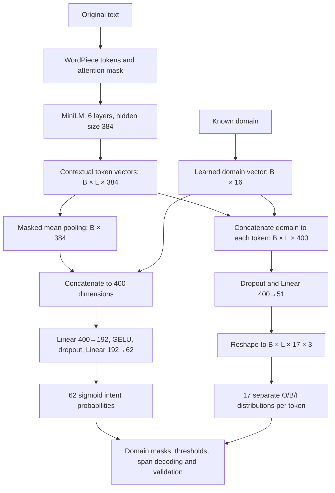

# Learning ReflexOne: from text to measured decisions

ReflexOne turns English text into a fixed set of labels, probabilities and extracted spans. The project contains a genuinely fine-tuned neural model, two locally trained classical classifiers, and the evaluation code needed to inspect their mistakes. Start by understanding one prediction, then connect it to the training and evaluation pipeline.

This guide is based on the checked-in implementation, configuration and reports. It is a study resource: the small exercises ask you to explain or change a piece yourself. You do not need to know transformers before beginning.

## 1. Understand the four use cases

There are four use cases and three artifact profiles. Banking and hotels share a single neural model; commands and spam have separate classical models.

| Use case | Input | Learned output | Model family |
|---|---|---|---|
| Banking support | A request and known domain `banking` | Multiple intent modules and exact text spans | Fine-tuned MiniLM with parallel heads |
| Hotel support | A request and known domain `hotels` | Multiple intent modules and exact text spans | The same support network, conditioned on a different domain |
| Assistant commands | A request | One of 150 supported intents, or empirical OOS rejection | TF-IDF multiclass logistic regression |
| SMS screening | A message | `ham` or `spam`, with probabilities | TF-IDF Complement Naive Bayes |

An intent describes what a message concerns: asking for information, a card, a booking, cancellation. A slot identifies a relevant part of the original message: a date, a money amount, a company name. Label names come from the datasets rather than a hand-created list of business outcomes. The code never blocks cards, makes reservations, plays music or sends messages.

An illustrative banking request can concern both a `card` and `lost_stolen`. Several labels can be true simultaneously. This makes support **multilabel classification**. The commands benchmark gives each request one supported intent, making its supported-class problem **multiclass classification**. Spam is binary classification with `spam` as the positive class.

**Check yourself:** Why would a single softmax over the 62 support labels be a poor match to this dataset? Explain what would happen to a request with three valid intent modules.

## 2. Connect the Jev idea to this implementation

The [TypeSafe Jev article](https://typesafe.ai/blog/introducing-system-one-models-and-jev) motivates an interface: unstructured input in, typed probabilistic decisions out. ReflexOne applies that idea to narrow supervised tasks with public labels. It does not implement TypeSafe's proprietary architecture, parallel sampler or Reinforcement Learning for Calibrated Decisions.

The support network runs its encoder once and calculates all intent logits and token-slot logits from that representation. It does not generate a JSON response one token at a time. Ordinary code decodes the logits and validates the response. “Parallel” refers to the output heads sharing a forward pass; the transformer still processes six layers in sequence.

Typed output constrains the interface. Pydantic verifies that an intent is a known label, that a probability is finite and between zero and one, and that a slot's text exactly matches `input[start:end]`. It cannot prove that the label applies or that the extracted words answer the user's question. A valid prediction can be wrong.

## 3. Run a prediction before studying the network

Use the repository root. `uv sync --extra dev` installs the locked project environment. Prediction requires already trained or downloaded artifacts; the training commands below create them.

```bash
uv sync --extra dev
uv run reflexone profiles
uv run reflexone predict --domain banking --text "My card was stolen last night. Please block it." --selected-only
uv run reflexone predict --domain hotels --text "Can I book two rooms for three adults next Friday?" --selected-only
uv run reflexone predict-task commands --text "turn the bedroom lights on"
uv run reflexone predict-task spam --text "WIN cash prize free lottery claim now"
```

These are demonstration inputs, not evaluation data or expected-answer assertions. Inspect the output for mistakes. In the banking example, the saved model extracts `last night` at `[19,29)`: character 19 is included and character 29 is excluded. It can also select an extra intent, illustrating why a plausible demonstration is not a quality measurement. `--selected-only` is a display filter; ordinary support output includes every domain-valid intent and its true/false decision.

The support caller supplies the domain. The model does not infer whether a request is banking or hotel support. Giving it the wrong domain changes its domain embedding and allowed-label mask.

**Check yourself:** Run the same short request with both domains. Which differences arise from the allowed output labels, and which can arise from learned domain conditioning?

## 4. Follow the neural model's tensor shapes

Read [model.py](../src/reflexone/model.py), starting with `DecisionNetwork.forward`.



`B` is the number of requests in a batch; `L` is the number of tokens in that batch. A dimension such as 384 means each token is represented by 384 learned numbers. A **contextual** vector depends on the surrounding text, so the same token can have a different representation in another sentence.

The pinned backbone is `sentence-transformers/all-MiniLM-L6-v2`, revision `1110a243fdf4706b3f48f1d95db1a4f5529b4d41`. The actual saved encoder configuration has six transformer layers, hidden size 384, twelve attention heads, feed-forward size 1,536 and vocabulary size 30,522. Each attention head uses a 32-dimensional subspace. The application caps input at 128 WordPiece tokens even though the underlying architecture supports more positions.

The project loads the transformer through `AutoModel`. It implements its own attention-mask mean pooling; it does not run the complete SentenceTransformer embedding pipeline or normalize the pooled vector to unit length. The mask excludes padding from the mean; attended special tokens remain included. Training crops each padded batch to its longest actual sequence to avoid unnecessary work.

The 16-dimensional domain vector is concatenated **after** the transformer to the pooled representation and each token vector. It is not a prompt or a predicted label. Domain masks remove inapplicable labels from losses and responses: 48 banking/40 hotel intent modules and 13 banking/14 hotel slot types. The unions contain 62 intent modules and 17 slot types.

The saved architecture contains **22,822,657 parameters marked trainable**, comprising 22,713,216 backbone parameters and 109,441 parameters in the new heads/domain embedding. The inherited BERT pooler has 147,840 parameters but is not used by this forward pass, which reads `last_hidden_state`. The metadata count is therefore a nominal trainable-parameter count, not evidence that every tensor received a gradient.

## 5. Why sigmoid and independent BIO heads matter

A logit is an unrestricted numerical score. For support intent module `c`, its probability is:

```text
p_c = sigmoid(z_c) = 1 / (1 + exp(-z_c))
```

Each `p_c` estimates a separate yes/no event. Values do not sum to one. They are marginals; correlations can remain because all outputs share an encoder. Multiplying the probabilities is not a justified probability that the complete set of labels is correct.

Slots use a different local decision. At each token, each slot type gets three scores:

- `O`: outside a span of this type.
- `B`: beginning of a span of this type.
- `I`: inside a span of this type.

A softmax normalizes those three scores for **one slot type at one token**. A single linear layer computes 51 scores, which are reshaped into 17 separate three-class heads. The model does not use one mutually exclusive 35-class BIO stream. Separate streams can represent, for example, `date="this afternoon"` and overlapping `time_period="afternoon"`. Two real source examples require cross-type overlaps.

The decoder copies the span's value from the original text; it does not generate or normalize it. `next Friday` remains `next Friday`, not a calendar date. An orphan `I` starts a span. There is no CRF enforcing global BIO transitions. The returned `token_score` is the minimum selected tag probability along that span, an uncalibrated summary rather than a calibrated span-correctness probability.

The data loader checks exact character bounds, and alignment requires gold spans to match tokenizer boundaries. A truncated or unrepresentable gold entity raises an error rather than silently disappearing. All 1,964 canonical gold spans aligned exactly in the recorded run, and no prepared example was truncated.

**Check yourself:** Draw two BIO streams for “only today” where `date_period` covers both words and `date` covers only “today.” Explain why one exclusive BIO stream would lose an annotation.

## 6. What “we trained the model” means

**Pretraining** learned general language representations before this project. The upstream MiniLM family uses transformer distillation, and this particular Sentence Transformers checkpoint was further trained for sentence representations. ReflexOne reuses those weights; it does not recreate either upstream process.

**Fine-tuning** updates the pretrained backbone and newly initialized task heads using the real NLU++ labels. That is what support training does. **Training from scratch** would initialize the language encoder randomly and learn language/task representations from the available data; it is not how this support model was built. The classical profiles fit new TF-IDF vocabularies and classifiers from their training partitions without pretrained language weights.

For one training batch, the code performs forward prediction, computes a differentiable loss, backpropagates gradients, clips their global norm, and applies an optimizer step. The gradients measure how changing parameters would change the current training loss. Evaluation and prediction use `eval()` and inference mode and do not update parameters.

The combined support loss is:

```text
L = mean masked binary-cross-entropy(intent logits, intent labels)
    + slot_weight × weighted cross-entropy(valid BIO logits, gold tags)
```

`slot_weight=1`. Binary cross-entropy penalizes each applicable intent decision; its positive term is upweighted for rare classes. For class `c`, the positive weight is approximately `sqrt(negative_count / positive_count)`, calculated only from training counts and clipped between 1 and 8. The square root moderates the much larger full inverse-frequency ratio. It is a design choice, not evidence of optimality.

Slot cross-entropy weights `O/B/I` by `[1,4,4]`, giving the rarer span tags more influence. Domain-inapplicable labels, padding and special-token slot positions do not contribute to their losses. Upweighting positives can affect probability calibration, another reason to inspect probabilities on held-out data.

The actual [configuration](../configs/support.json) uses AdamW, backbone learning rate `3e-5`, head learning rate `1e-3`, weight decay `0.01`, batch size 32, and maximum length 128. Newly initialized heads receive a larger learning rate than the pretrained representation. The schedule warms up for 5% of the planned steps and then uses cosine decay toward a 10% learning-rate floor. Gradients are clipped to norm 1.0. New-head dropout is 0.15; the inherited encoder configuration has dropout 0.1.

Fourteen epochs were permitted, with early-stopping patience four. Each epoch searches the raw intent threshold on validation data and scores the mean of validation intent micro-F1 and exact slot F1. The best recorded checkpoint was epoch 14. This records an improving validation-selected result within the chosen budget, not proof of global convergence. The recorded training loop took 65.5 seconds using Apple's MPS accelerator; that time excludes downloading and later evaluation/baseline work. CPU inference was measured separately.

## 7. Keep four data jobs separate

Read [data-audit.md](data-audit.md) for the audit and [reliability.md](reliability.md) for exact numerical conventions.

| Partition | Support rows | Permitted use |
|---|---:|---|
| Training | 1,968 | Vocabulary/features where applicable; neural weights; training class weights |
| Validation | 455 | Checkpoint, raw decision threshold and empirical review-rule selection |
| Calibration | 302 | Fit the probability temperature with model weights fixed |
| Test | 302 | Evaluate the final frozen procedure |

The source has 3,080 examples. After quarantining 16 conflicting rows and collapsing nonconflicting duplicates, 3,027 examples remain in 3,024 global normalized-text groups. A text appearing in both domains stays in one global partition. Original text/offsets are preserved. NFKC/casefold/whitespace normalization only creates the grouping key.

The split is custom, approximately 65/15/10/10 and stratified by domain membership, not every rare label. Its seed is 17; the model seed is 42. Freeze the split when comparing models. Changing the dataset split and the model together confounds the comparison. This protocol differs from NLU++'s paper cross-validation, so the numbers are not a paper leaderboard comparison.

Validation is reused for several decisions. Its selected result is optimistic; the independent test evaluates the combined procedure. The 302-example calibration set contains **zero positive examples for `accesibility` and `business`**, preserving the original ontology spellings. A single pooled temperature cannot establish reliable per-class calibration for those labels. Sparse slot types also have very small test support.

**Check yourself:** If you try five slot-loss weights after reading test F1 each time, what has happened to the role of the test partition? Describe a better experiment using a fresh test set or nested development protocol.

## 8. Understand calibration and review

Temperature scaling changes logit magnitude with fixed weights:

```text
p_calibrated = sigmoid(z / T)
threshold_calibrated = sigmoid(logit(threshold_raw) / T)
```

Support uses `T=0.85384`, a raw threshold of `0.66`, and a calibrated threshold of approximately `0.68500`. The threshold is transformed with the logits. Because the transform is monotone, selected labels stay the same apart from numerical edge cases. Calibration therefore changes probability quality without silently changing the intent decision policy.

Calibration asks whether sets of similarly scored predictions have corresponding observed frequencies. It does not certify an individual prediction. NLL penalizes confident mistakes; Brier score is squared probability error. ECE compares average predicted probability and observed frequency in bins. Pooled multilabel ECE can look low because most valid label–example pairs are negative. Read supported-label ECE and per-label support alongside it.

Support review uses the minimum raw distance from any valid intent probability to the raw threshold. A small margin signals an unstable decision boundary. Validation chooses an empirical cutoff; the deployed rule also reviews empty intent predictions and truncated input. This score does not measure slot correctness, and it is not supervised OOS detection or a conformal guarantee. The support report's `review` block gives the frozen deployed rule's observed test coverage and risk; do not interpret a target error level as a guaranteed error rate. If no validation group qualifies, reviewing all requests is an honest outcome.

The command profile has a separate **supervised** OOS experiment using CLINC's OOS validation/test labels. Its 150 class probabilities are conditional on a supported intent. Their maximum is not `P(in-scope)`. Spam has no validated OOS mechanism.

## 9. Read the results without hiding the difficult parts

The following table describes the fixed primary seed-42 result on custom, audited held-out partitions. Two unchanged-configuration seed checks are shown afterward; none of these measurements supplies a confidence interval over future requests.

| Measurement | Recorded result | Interpretation |
|---|---:|---|
| Support intent micro-F1 | 86.86% | Pooled recovery of applicable intent modules |
| Support intent macro-F1 | 85.17% | Equal weight per valid label, including sparse labels |
| Support exact intent set | 64.90% | All valid intent decisions correct together |
| Support exact slot-span F1 | 61.45% | Correct type and exact start/end required |
| Support slot precision / recall | 51.82% / 75.48% | Too many extra spans remain |
| Support complete frame | 46.69% | Both full intent set and full span set correct |
| Banking / hotel intent micro-F1 | 88.84% / 80.94% | Aggregate performance hides a domain gap |
| Commands supported-intent accuracy | 90.86% | Before rejecting uncertain requests |
| Commands OOS recall | 92.30% | Of 1,000 test OOS requests, 923 rejected |
| Commands accepted accuracy / coverage | 96.05% / 63.59% | Accuracy requires reporting its coverage cost |
| Spam positive-class F1 | 94.57% | Spam precision 93.85%, recall 95.31% |
| Spam accuracy | 98.64% | Also inspect the imbalanced positive-class metric |

The support TF-IDF one-vs-rest logistic baseline reaches 76.18% micro-F1, so the neural model improves the observed intent score by **10.69 percentage points**. This comparison is about intents: the lexical baseline has no slot extractor. It does not establish a 10.69-point improvement in complete-frame quality.

The original artifact remains seed 42; it was not selected by comparing final test seeds. Two additional training seeds use the same architecture, configuration and frozen data split. Their checkpoints are selected separately on validation. See the [three-run summary](../reports/support-seeds.json) and individual [seed-7](../reports/support-seed7.json) / [seed-123](../reports/support-seed123.json) reports.

| Support training seed | Intent micro-F1 | Exact slot F1 | Complete-frame accuracy |
|---|---:|---:|---:|
| 42, fixed primary | 86.86% | 61.45% | 46.69% |
| 7 | 84.88% | 59.57% | 42.38% |
| 123 | 86.04% | 63.51% | 47.68% |

These runs expose sensitivity to initialization, shuffling and training randomness. They reuse the same test cases, so they are not three independent test sets or an estimate of uncertainty over a deployment population. Three seeds also do not isolate the effects of individual design choices.

Support calibration reduces test NLL from 0.03748 to 0.03671 and pooled ECE from 0.00876 to 0.00659. The support baseline's calibration improves its test NLL but slightly **worsens Brier score**, from 0.01992 to 0.02033. Calibration is not automatically beneficial on every measure.

There are 208 gold test spans: 157 true positives, 146 false positives and 51 false negatives. That explains why slot F1 limits complete-frame accuracy. Many examples have no gold spans, so a 73.84% exact slot-set accuracy does not replace the span precision/recall analysis. Read the saved error examples in `artifacts/support/errors.json` and per-type counts in the report before proposing a fix.

The command classifier was selected by validation macro-F1; spam selected ComplementNB by validation spam F1. Their alternative algorithms and calibration ablations remain in the reports. Detailed methodology is in [classical-profiles.md](classical-profiles.md).

## 10. Reproduce a full experiment

These commands match the implemented CLI. Network access is needed for missing public data and the pinned encoder. Training writes generated data/weights under ignored directories. To explore a new experiment, use a new artifacts directory so the delivered checkpoint remains available. Test results from this project are already known; a later change is an exploratory iteration unless evaluated with a fresh final holdout.

```bash
uv run reflexone prepare --data data/support --seed 17
uv run reflexone train --data data/support --artifacts artifacts/support --config configs/support.json --seed 42 --output reports/support.json
uv run reflexone evaluate --data data/support --artifacts artifacts/support --output reports/support-recheck.json
uv run reflexone benchmark --artifacts artifacts/support --repeats 120 --output reports/support-benchmark.json

uv run reflexone prepare-task commands --seed 17
uv run reflexone train-task commands --seed 42 --output reports/commands.json
uv run reflexone evaluate-task commands --output reports/commands-recheck.json
uv run reflexone benchmark-task commands --repeats 100 --output reports/commands-benchmark.json

uv run reflexone prepare-task spam --seed 17
uv run reflexone train-task spam --seed 42 --output reports/spam.json
uv run reflexone evaluate-task spam --output reports/spam-recheck.json
uv run reflexone benchmark-task spam --repeats 100 --output reports/spam-benchmark.json
uv run pytest -q
```

Training emits support epoch progress before the final JSON. An output path gives you a clean report file. `train-task` reports do not embed a benchmark automatically; the separate benchmark command saves its own result. Checked-in command/spam reports also contain the original measured benchmark block from their initial experiment script.

Serving loads available profiles once, rather than loading weights for every request:

```bash
uv run reflexone serve --artifacts-root artifacts --host 127.0.0.1 --port 8000
```

The local API offers `/health`, `/profiles`, `/predict`, and `/predict/batch`; its FastAPI documentation is at `http://127.0.0.1:8000/docs`. A support request is `{"profile":"support","domain":"banking","text":"My card was stolen"}`. A spam request is `{"profile":"spam","text":"Claim a free prize"}`. The API accepts at most 4,000 characters per request and 32 requests per batch. Its batch route loops over loaded predictors; it is not a fused neural batch-performance claim.

The support benchmark measures warm batch-one CPU tokenization, encoder/heads, decoding and schema validation: p50 5.34 ms and p95 6.71 ms over 120 runs on six short cases. It excludes process startup, loading and HTTP. Training used MPS, so this is a separate CPU inference measurement. Classical timings are also warm and local, with a narrower output-validation scope. These measurements do not establish remote-service speedups.

## 11. Read and change the code in a useful order

| Order | Files | What to explain before moving on |
|---|---|---|
| 1 | [schema.py](../src/reflexone/schema.py), [inference.py](../src/reflexone/inference.py) | What makes an output valid, and what can remain wrong? |
| 2 | [data.py](../src/reflexone/data.py), [data-audit.md](data-audit.md) | How do groups, exact spans and quarantine prevent misleading scores? |
| 3 | [model.py](../src/reflexone/model.py) | Trace `[B,L,384]` into both output families. |
| 4 | [training.py](../src/reflexone/training.py), [support.json config](../configs/support.json) | Identify every weight update and every validation decision. |
| 5 | [reliability.py](../src/reflexone/reliability.py), [reliability.md](reliability.md) | Prove threshold transformation preserves decisions. |
| 6 | [tasks.py](../src/reflexone/tasks.py), [classical-profiles.md](classical-profiles.md) | Explain multiclass vs multilabel objectives and OOS tuning. |
| 7 | [api.py](../src/reflexone/api.py), [cli.py](../src/reflexone/cli.py) | Explain loading, validation and timing boundaries. |
| 8 | [support report](../reports/support.json), errors and tests | Find one supported conclusion and one limit for every headline metric. |

Practice by tracing one training example from JSONL to token offsets, targets, loss, logits and final span. Then write a tiny hand-calculated precision/recall example and compare it with the metrics functions. Finally, propose an improvement that addresses an observed validation error: for example, span overprediction. State the expected effect and the validation experiment before changing code. Domain-embedding, class-weight, frozen-encoder and independent-head ablations are useful future experiments; they have not been measured here.

## Glossary and self-check

| Term | Meaning in this project |
|---|---|
| Parameter / weight | A number adjusted during fitting, such as an attention projection weight |
| Hyperparameter | A configuration choice such as learning rate, dropout or loss weight |
| Encoder | A network producing contextual representations of the supplied input |
| Head | A small task-specific mapping from representations to output scores |
| Gradient | Loss derivative used to choose an update direction |
| Epoch | One pass over training examples |
| Logit | Score before sigmoid or softmax |
| Marginal probability | Probability for one event, without a justified joint distribution |
| Calibration | Agreement between predicted probabilities and observed frequencies |
| Leakage | Information crossing a boundary that makes evaluation too optimistic |
| Mask | Boolean control over which labels/tokens are meaningful for a row |
| Precision / recall | Fraction of predicted positives correct / fraction of real positives recovered |
| F1 | `2 × precision × recall / (precision + recall)` |
| Micro / macro | Pool counts across labels / average label scores equally |
| Complete frame | Entire intent set and entire slot set correct on one request |
| Coverage / risk | Fraction accepted / observed error fraction among accepted requests |
| OOS / OOD | Outside supported intents / outside a modeled data distribution; related but not identical |
| Artifact | Saved weights, tokenizer, configuration, ontology and calibration needed for inference |

Without opening the answers in the code, explain: why there are 17 three-way slot heads; why the support probabilities do not sum to one; which partition fits temperature; why low ECE does not prove reliable rare-label probabilities; why accepted accuracy needs coverage; and why the current slot precision is an automation limit. Once you can demonstrate those answers with one real example, use the [interview guide](interview-guide.md) to practice a short presentation.
